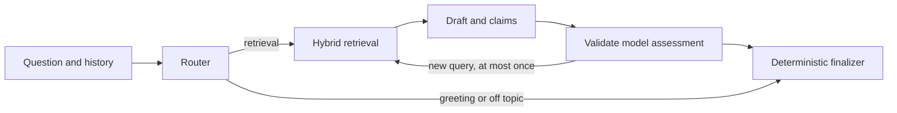

# Kestrel Research Assistant

A research prototype over the supplied Kestrel Labs assignment corpus: 154 document chunks about a fictional product's plans, APIs, runbooks, and policies. It combines dense embeddings and BM25 with Reciprocal Rank Fusion (RRF), then uses a LangGraph workflow to draft and assess claims.

**Verification is a model assessment, not a correctness guarantee.** Offline mode shows source excerpts without claiming they answer the question. A valid citation identifier proves that a source exists, not that it supports a claim.

## Workflow




- Dense search finds semantic matches; BM25 finds lexical matches. RRF combines their rank positions.
- The verifier must assess each draft claim exactly once, with allowed verdicts and real source IDs.
- A weaker claim verdict cannot be upgraded by an optimistic overall verdict.
- Only a nonempty, new refinement can trigger a retry. The counter advances when retrieval starts.
- The finalizer formats assessed claims directly; it makes no additional model call. Conflicting/insufficient evidence produces a cautious response with source excerpts.
- Verification status is separate from verdict: not requested, skipped, failed, or performed.
- Recovered provider errors remain visible to evaluation and the interface.

## Setup (tested on Python 3.12)

Clone the repository, then run commands from its root:

```text
git clone https://github.com/sankirthrbhat/kestrel-research-assistant.git
cd kestrel-research-assistant
python -m venv .venv
```

Activate the environment:

- PowerShell: `.\.venv\Scripts\Activate.ps1`
- macOS/Linux: `source .venv/bin/activate`

Install and build the local index:

```text
python -m pip install -r requirements.txt
python -m kestrel.ingest
```

The first ingestion downloads the public BAAI/bge-small-en-v1.5 embedding model. An LLM key is not needed. Subsequent local retrieval reuses the downloaded model and persistent Chroma/BM25 indexes.

The corpus is read-only to the application. Its committed SHA-256 is
`b401a4f906446f4e93f1d58c714918acf40d94d81a80c6358e5b7edd46cbbb41`.
A Git attributes rule preserves LF line endings on Windows, so a fresh checkout retains this digest.

## Run

```text
python -m streamlit run app.py
```

Or use `python -m kestrel.cli` for the terminal interface.
`run.ps1` / `run.sh` build/reuse the index and launch the CLI.

Try “How many Beacons can a project have on each plan?” Inspect the source excerpts and the verification status. The UI retains status and sources in conversation history.

### Offline mode

No key means offline source browsing. To force it even if keys exist:

- PowerShell: `$env:KESTREL_OFFLINE = '1'`
- macOS/Linux: `export KESTREL_OFFLINE=1`

Offline routing uses simple keywords and does not reliably resolve pronouns. Retrieved passages can be irrelevant. They are labeled unverified; offline output is not an answer-quality benchmark.

### Optional model configuration

Copy .env.example to .env and set an OpenAI-compatible endpoint, API key, and model you can access. No secrets are required for tests or the deterministic demo.

| Variable | Purpose |
| --- | --- |
| KESTREL_OFFLINE | Set to 1 to disable model calls |
| KESTREL_LLM_API_KEY | Explicit provider key |
| KESTREL_LLM_BASE_URL | OpenAI-compatible base URL ending in /v1 where appropriate |
| KESTREL_LLM_MODEL | Model identifier available through that provider |
| KESTREL_LLM_TIMEOUT | Per-request timeout in seconds |
| KESTREL_STRATEGY | dense, bm25, or hybrid; default hybrid |
| LANGCHAIN_TRACING_V2 | Optional tracing; disabled by default |
| LANGCHAIN_API_KEY / LANGSMITH_API_KEY | Optional tracing key |

Existing GROQ_API_KEY, GEMINI_API_KEY, OPENAI_API_KEY and DEEPSEEK_API_KEY aliases remain supported, in that priority order after the explicit key. Override the model when provider availability changes. Model API calls can incur provider charges. No application feature requires LangSmith.

## Tests and deterministic demonstration

For lightweight workflow tests without embeddings:
```text
python -m pip install -r requirements-core.txt
python -m pytest -q
python -m kestrel.demo
```

The demo uses explicitly mocked model responses and retrieval to show three control-flow cases: supported, insufficient evidence, and one useful retry. It is not a quality benchmark or a live-provider demonstration.

For real retrieval integration tests, install the full requirements, build the index, and run:
```text
python -m pytest -q --integration
```

Tests isolate credentials and block unmocked model API calls. The default suite skips real-index tests; missing/stale indexes cause an explicit failure when --integration is requested. CI runs the lightweight suite on Windows and Linux.

## Reproducible evaluation

Reports are local JSON files. Use a new output directory for every run; old reports are never overwritten.

Compare retrieval with identical corpus, questions, k, and model:
```text
python -m eval.run_eval --mode retrieval --strategy dense --k 5 --tag dense --out-dir results/runs/dense
python -m eval.run_eval --mode retrieval --strategy hybrid --k 5 --tag hybrid --out-dir results/runs/hybrid
```

These are retrieval metrics, not answer accuracy. Questions without relevance labels are excluded from Recall/MRR means; scored sample sizes are reported. Raw follow-ups are not rewritten in retrieval-only mode.

For a complete workflow run:
```text
python -m eval.run_eval --tag workflow --out-dir results/runs/workflow
```

Add --judge only when you want extra model calls to score correctness, relevance and faithfulness. Without it, answer quality is unscored. Judge failures are recorded separately; a verifier verdict is never treated as ground-truth faithfulness. Token totals are currently unknown (null), not zero.

Reports record commit, source hashes, corpus/dataset hashes, Python/dependency versions, retrieval settings, provider/model, failures and scored sample sizes. Conversations are grouped and sorted by turn; a failed prerequisite turn causes dependent turns to be skipped. Means exclude failed/skipped cases, so always read failure counts alongside them.

The 20-question dataset is a small development set with manually authored references, not an independent held-out benchmark. Historical reports under results/ describe earlier code and are not evidence of current answer quality. See [repair validation](docs/repair-validation.md) for the actual checks performed on this revision.

## Limitations and provenance

This began as a research-assistant assignment; Kestrel Labs is the supplied example domain. No production deployment or real customer impact is claimed.

Model assessments can miss unsupported facts and prompt injection. Strict schemas and source-ID validation reduce failure modes but do not solve semantic verification. The conservative finalizer sometimes refuses a useful answer, especially with conflicting sources. There is no verified production accuracy, human-rated evaluation, or measured performance gain claimed here.

See [step-by-step explanation](docs/repair-guide.md) for the defects, fixes, and interview walkthrough.
